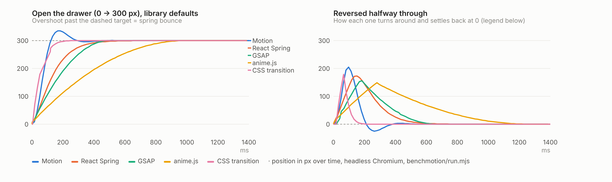

# Motion and micro-interactions

`ux-find` reads this for any animation, transition or "make it feel smooth" request, and for loading, toast and
state-feedback questions. **Step 1** asks whether to animate at all. **Step 2** picks the tool from the job, using the
benchmark in `benchmotion/` (six options, same four tasks). **Step 3** lists motion defaults, and **step 4** state and
feedback defaults. All are starting points: depart when the situation calls for it and say why.

Research behind this guide: `research/A5-A6-motion-states.md` (sources cited there).

## 1. Should this move at all?
| Situation | Do | Why |
|---|---|---|
| Keyboard-initiated actions, the command palette, things used hundreds of times a day, per-keystroke filtering, table sorts | **No animation** | Repetition turns motion into delay; Raycast and Emil Kowalski both ship none here |
| A second tooltip while one is open | Show instantly | The first delay already established intent |
| Hover, press, colour, focus | 100–150 ms, CSS | Feedback should feel immediate |
| Something appears, moves or changes size (popover, dialog, list item, panel) | Animate, 200–300 ms | Shows where it came from and where it went |
| Rare, meaningful moments (first run, success after a long task, empty states) | Can afford more | Delight is cheap when it's rare |
| Live data updating ≥ once a second | Swap values, maybe a brief colour flash | Rolling digits every second is noise |

## 2. Tool: which source fits the job?
Overall scores are in `SOURCES.md` (motion section); **fit beats score**. Start from the first row that matches.

| If the job is… | Use | Score | Why (evidence) | Runner-up |
|---|---|---|---|---|
| Hover, press, popover/dialog enter and exit, route and shared-element transitions | **CSS + `<ViewTransition>`** (`native-css`) | 8.0 | 4/4 bench tasks with no library, ~1 KB; React 19.3's `<ViewTransition>` is stable and Next 16 needs no config; only option whose scroll animation ran off the main thread | Motion |
| Springs, drag and gestures, interruptible layout changes, list reorder with exits, `layoutId` tab underlines | **Motion** | 8.3 | 4/4 with built-in features; presence and transforms via WAAPI; springs keep velocity when retargeted; 49.5 KB gz (~10 KB first load with `LazyMotion`) | React Spring |
| A list whose items come and go, nothing else | **AutoAnimate** | 7.0 | One hook, 3.4 KB, reduced motion on by default; can't do anything beyond add/remove/move | Motion |
| Marketing scroll stories, pinned scenes, SVG and text effects that must match across browsers | **GSAP** | 6.8 | Widest feature set (Flip, ScrollTrigger, SVG, text), lowest script time (47 ms); free but **not open source** (Webflow licence bars no-code animation builders) | anime.js |
| Vanilla or non-React pages wanting MIT timelines | **anime.js** | 6.3 | Small, capable; default 1 s duration and no reduced-motion support | GSAP |

Not worth adding for new work: **React Spring** (6.5) does less than Motion with the highest main-thread cost in the bench
(150 ms vs Motion 81 ms for 60 boxes at 4× CPU throttle) and no layout primitive. Rive and Lottie are illustration runtimes
with paid authoring tools, not UI motion systems. For illustrations that must react to state, **Rive** (`sources/rive`, MIT runtime):
self-host its 884 KB gz WebAssembly (it loads from unpkg by default) and gate autoplay on reduced motion yourself. For a fixed
one-shot flourish, a pre-rendered clip played once on select is far lighter (`navigation/airbnb-3d-category-icon-tabs`).

What the bench found that changes defaults:
- **Library defaults are not UI defaults.** Motion's default spring overshoots 12% (35 px on a 300 px move); anime.js takes
  1 s; React Spring 680 ms. Set app-wide timing once (below) instead of trusting defaults.
- **Reduced motion is off by default everywhere except AutoAnimate.** Motion needs `<MotionConfig reducedMotion="user">`.
- **View Transitions can't be interrupted.** A new one skips the running one. Use them for navigation and one-shot changes,
  and Motion or CSS transitions for anything a user can reverse mid-flight.
- **Exit animations in React are only built in** with Motion (`AnimatePresence`), React Spring (`useTransition`),
  AutoAnimate and `<ViewTransition>`. With GSAP and anime.js we had to keep removed items rendered by hand.

## 3. Motion defaults (guidance, not rules)
| Default | Why | When to depart |
|---|---|---|
| Duration tokens: `--duration-fast: 150ms` (hover, press, colour), `--duration-base: 200ms` (dropdown, popover, tooltip), `--duration-slow: 300ms` (dialog, sheet, large layout move). Exits 20–30% shorter | NN/g: most UI motion 100–400 ms, "at 500 ms… a real drag"; Material 3's grid agrees | Storytelling pages (400–1000 ms); very long travel across a wide screen (350–400 ms) |
| Easing tokens: enter/move `cubic-bezier(0.2, 0, 0, 1)`; emphasised enter `cubic-bezier(0.05, 0.7, 0.1, 1)`; exit `cubic-bezier(0.3, 0, 0.8, 0.15)`; `linear` for progress and scroll-scrubbed motion | Ease-out reads as responsive; values from Material 3's token source | Never `ease-in` on entrances |
| Springs only for gesture-driven, retargeted or layout motion; **no bounce** in UI chrome: Motion `{ type: 'spring', visualDuration: 0.25, bounce: 0 }`, set once in `<MotionConfig transition>` | Springs carry velocity into a new target; bounce in chrome reads as sloppy. The bench showed Motion's default overshooting 12% | `bounce: 0.15–0.3` for a playful moment or a thrown gesture's release |
| Toggled state uses **transitions** (CSS `transition` or springs), never `@keyframes` | Transitions retarget from the current value; keyframes restart | Keyframes for one-shot loops (spinner, shimmer, ping) |
| Popover, dialog and menu enter/exit in CSS: `@starting-style` + `transition-behavior: allow-discrete` | Zero JS; Baseline in all three engines | Motion `AnimatePresence` when exits need orchestration (lists, stagger) |
| Shared element and route changes: `<ViewTransition name>` inside `startTransition`; keep them ≤ 300 ms | Stable in React 19.3, config-free in Next 16; passed the bench | Interruptible or drag-driven layout: Motion `layout`/`layoutId` |
| Animate `transform` and `opacity` only; list properties explicitly; never `transition: all`; never animate `backdrop-filter` | Compositor-only properties stay smooth under load | Small elements can animate `filter`/`clip-path`. For size changes, use FLIP (Motion `layout`) |
| Scroll-driven animation only for progress bars, condensing headers and reveal-on-enter, in `@supports (animation-timeline: view())`. Never hijack scroll | Runs off the main thread with no JS. Not in Firefox yet, so it must be an enhancement | Story pages (F2) can use GSAP ScrollTrigger for cross-browser parity |
| **Reduce, don't remove:** under `prefers-reduced-motion: reduce`, swap movement and zoom for ≤ 200 ms fades; stop parallax, autoplay and scroll-linked motion; keep state feedback. In Motion set `reducedMotion="user"` at the root; in CSS use Tailwind `motion-safe:`/`motion-reduce:` and cover `::view-transition-*` | Apple HIG and WCAG 2.3.3; Motion's `"user"` mode drops transforms but keeps opacity | Essential motion (a progress indicator, a drag following the pointer) stays |

## 4. States and feedback defaults (guidance, not rules)
Component choices for toasts, drawers and dialogs belong with the primitives decision in `guides/accessibility.md`; this
section owns timing and behaviour.

| Default | Why | When to depart |
|---|---|---|
| Every control has default, hover, active, focus-visible, disabled and (where relevant) selected, loading, error. Hover, active and focus *raise* contrast; press = darker fill or `scale(0.97–0.98)` at 100–150 ms | Vercel interface guidelines; WCAG 2.4.7 | – |
| Disable only when an action is impossible right now, and say why; otherwise keep it enabled and validate on submit. Use `aria-disabled="true"` when the reason must be reachable by keyboard | Geist Button guidance | – |
| Latency bands: < 100 ms nothing; 100 ms–1 s a subtle pending state, no spinner; 1–10 s an indicator; > 10 s determinate progress + Cancel. Mutations target < 500 ms | NN/g's 0.1 / 1 / 10 s limits; Vercel | Streaming AI output shows tokens instead (`guides/agentic-ui.md`) |
| Spinners and skeletons: **show after 150–300 ms, stay at least 300–500 ms** | No flash on fast responses; React `<Suspense>` helps | Actions known to be slow (export, deploy) show progress immediately |
| Skeleton for regions with known layout (must mirror the final layout, no shift); inline spinner for one control; determinate bar for > 10 s | NN/g; Vercel | Unknown layout: spinner, not a fake skeleton |
| Button loading keeps its label and width, adds a spinner and `aria-busy`, stays focusable, blocks re-submit, sends an idempotency key | Vercel; Geist | – |
| Optimistic UI when success is very likely and the action is reversible (toggle, rename, reorder, status). On failure: roll back, error toast with Retry, keep the user's input. Server Actions: React `useOptimistic`; client cache: TanStack Query | Feels instant; React reverts automatically | Never for payments, permissions, irreversible sends or server-computed values |
| **Undo by default** for reversible destructive actions: past-tense toast with one Undo, 5–10 s. Confirm only irreversible or costly actions; type-to-confirm only catastrophic ones | NN/g: confirmations get habituated | Bulk destructive actions: confirm with the count *and* offer undo |
| Toasts: Sonner (MIT). Bottom-right, ≤ 3 visible, 4 s (5–10 s or persistent with an action), pause on hover and hidden tab, polite live region, ≤ 6 words, one per async flow | Sonner's defaults match this (checked in its source) | Never toast-only for errors the user must act on, field validation, or billing/permission failures: use inline or persistent UI |
| Changing numbers: NumberFlow (MIT) for user-caused or rare changes; always `tabular-nums` | Motion's `AnimateNumber` is paid (Motion+) | Live data ≥ 1/s: no digit roll |
| Tooltips: ~500 ms first delay, then instant while moving between triggers. Submenus: a safe-triangle hover area | Emil Kowalski; Linear's "invisible details" | Exact tooltip delay is unverified; tune by feel |

## References
Bench: `benchmotion/` (`node run.mjs [lib]`, then `node chart.mjs`). Profiles: `sources/{motion,native-css,auto-animate,gsap,react-spring,animejs}`.
Live references (patterns): search `catalog.json` for `pattern: motion` and `pattern: feedback`.
